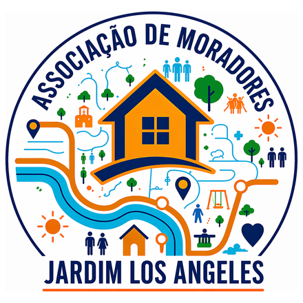

# JLA: Bairro em Jogo

Jogo do bairro da **Associação de Moradores do Jardim Los Angeles** (Ponta Grossa/PR).
O morador anda em 3D pelas ruas de verdade do Jardim Los Angeles, Califórnia I e II e Hortência,
cumpre missões, trabalha nas empresas do bairro, compra veículos elétricos, adota bichinhos
e disputa o ranking do mês.

- **Jogar:** abra o `index.html` no navegador (ou o link do GitHub Pages, quando estiver ligado).
- **Versão leve em pixel art:** `versao-2d.html`.

## Guia para quem vai mexer no jogo

Tudo fica em um arquivo só: `index.html`. Use **Ctrl+F** para achar cada parte pelo título entre `/* ============ ... ============ */`.

| O que você quer mudar | Procure por |
| --- | --- |
| Ruas, áreas e rios do mapa | `const ROADS`, `const AREAS`, `const WATER` |
| Lugares (sede, escolas, comércios, lojas) | `const POIS` |
| Missões e quanto cada uma vale | `const MISSIONS` |
| Missão do dia (7 missões que giram na semana) e bônus | `const DAILY`, `DAILY_PTS`, `WEEK_BONUS` |
| Fazenda Iberá (venda de sementes) | `function mkFazenda`, `function openSeedShop` |
| Horta comunitária (plantas, preço, tempo de crescer, doações) | `const CROPS`, `function openHorta`, `function openDonate` |
| Igreja, panfletos e campanha do agasalho | `function mkIgreja`, `function startRoute` |
| Bichinho que foge para o abrigo (chance e intervalo) | `function maybePetEscape` |
| Chuva (quantos dias chove) e viaduto alagado | `function rainyDay`, `function rainNow`, `function unclogFlood` |
| Missões surpresa (aceitar ou não) e recompensas | `const EVENTS`, `function startEvent`, `function evNear` |
| Serviços do posto (para-brisa, pneus, GNV, óleo, troca de pneu) | `function openPostoJobs`, `MG_VIDRO`, `MG_GAUGE`, `MG_TROCA` |
| Ordem dos joguinhos em cada lugar | `const JOB_ROT` |
| Veículos do lava-car (carro, moto, caminhonete, caminhão) | `LAVA_VEH`, `function vehArt` |
| Joguinhos "pegar no ar" e "memória" e seus temas | `const THEMES`, `function MG_CATCH`, `function MG_MEMO` |
| Trabalhos nas empresas | `const JOBS` |
| Joguinho de balcão (lanchonete, padaria, churrascaria): itens, cores, tempo | `const COUNTER`, `const FOOD`, `function gameCounter` |
| Trabalhos do Mercado (caixa, açougue, padaria, prateleira) | `function openMarketJobs`, `MG_CAIXA`, `MG_ACOUGUE`, `MG_PRAT` |
| Visual dos joguinhos (botões, tela de início, estrelas) | `function miniGame`, `function btn3d` |
| Dia e noite (duração do dia, cores do céu) | `DAY_MIN`, `const DN`, `function updateDayNight` |
| Passarinhos e gato caçando | `function updateBirds`, `function feedBird`, `function catHunt` |
| Música e sons | `function sfx`, `const MUS`, `function musicTick` |
| Desenho do cachorro e do gato | `function makePet`, `function petOutfit` |
| Outros joguinhos dos trabalhos (caixa, posto, fundição, solda, cargas, paletes, lava-car, ferro-velho) | `MG_CAIXA`, `MG_POSTO`, `MG_LINHA`, `MG_CARGAS`, `MG_PILHA`, `MG_LAVA`, `MG_RECICLA` e `function miniGame` |
| Perguntas do quiz | `const QUIZ` |
| Códigos do comércio (moedas no balcão) | `const COMERCIO` |
| Veículos e preços | `const VEH` |
| Cachorros e gatos para adotar | `const PETV` |
| Personagens (cores) | `const AVATARS` |
| Falas do Everton (Family Burguer) | `function talkEverton` |
| Construções em 3D | funções `mkAssoc`, `mkShop`, `mkFactory`, `mkGarage`... |
| Viaduto de entrada (posição e altura) | `const VIA` e `function buildViaduct` |
| Reforma da casa (cores e preços) | `WALLC`, `ROOFC`, `MUROC` e `function openReform` |
| Visual de desenho animado | `TOONG` e `function lam` |
| Rosto e corpo dos personagens | `function makeChar`, `function charHair`, `function charHat`, `function charGlasses` |
| Menino / menina / neutro e cabelos de cada um | `GENS`, `GEN_HS` |
| Roupas, estampas, calçados, chapéus e óculos | `TOPS`, `BOTTOMS`, `PRINTS`, `SHOES`, `HATS`, `GLASSES` |
| Desenhos para colorir no mural do viaduto | `const MURAL_T` |
| Palavras proibidas nos recados e ideias | `BAD_EXACT`, `BAD_STEM`, `BAD_PHRASE` |
| Mural de ideias da sede | `SUG_CATS`, `function openSuggest` |
| Logo da Associação | `const LOGO_URI` |
| Perfil (apelido, casa, pele, cabelo, roupas) | `const LOOKS`, `HAIRS`, `function openProfile` |
| Mochilas | `BAGS`, `function charBag` |
| Roupinhas dos bichinhos | `PET_OUTFITS`, `function petOutfit` |
| Botão "Casa" | `function goHome` |
| Desenho do carro e das bikes | `function makeVehicle` |
| Veículos só andam na rua | `function offRoad`, `function roadConstrain` |
| Correio do Bairro (recados, frases prontas, bloqueio) | `MAIL_FRASES`, `MAIL_EXTRA`, `function openWrite`, `function openInbox` |
| Bateria e tomada de casa (tempo de carga, alcance) | `CHARGE_MIN`, `range` em `const VEH`, `function openCharge` |
| Servidor Firebase (chave do projeto, login anônimo) | `FB_CFG`, `function initFirebase` |
| Ranking do mês de verdade | `function pushRank`, `function loadRanking` |
| Convites contados de verdade | `function syncInvites` |
| Morar junto (pedido, aceitar/recusar, reforma compartilhada) | `function claimHouse`, `function houseTaken`, `function answerReq`, `function openHouseMates` |
| Entrar com Google e jogo salvo na conta | `function googleLogin`, `function pushCloud`, `function pullCloud` |
| Instalar como aplicativo (botão, aviso, iPhone) | `function doInstall`, `function installBox`, `function maybeOfferInstall`; arquivos em `site-firebase/public` |
| Pizzaria Ilse (montar pizza, forno, entregas, horta) | `PZ_REC`, `function MG_MONTA`, `function MG_FORNO`, `function openIlseJobs`, `function startPizzaRoute`, `function startFetch` |
| Tela de carregamento (logo, barra, dicas, aviso de erro) | `
` e `loadStep` no começo do arquivo |
| Limite de bichinhos por casa (3 gatos, 2 cachorros) | `PET_LIM`, `function houseHasPets` |
| Celular deitado (interface compacta, tela cheia) | `@media (max-height:500px) and (orientation:landscape)`, `function goFullscreen` |
| Código da casa para morar junto | `function houseCode`, `function joinByCode` |
| Escolher o veículo | `function openRidePick` |

### Como colocar um comércio novo

1. Em `const POIS`, copie uma linha de loja (`type:"shop"`) e troque `id`, `name`, `addr`, `sign`, a cor `roof` e a posição `x`, `y`.
   A posição está em metros: `x` cresce para o leste e `y` para o sul, a partir da latitude -25.052 e longitude -50.200.
2. Se ele tiver um trabalho, acrescente uma entrada com o mesmo `id` em `const JOBS`.
3. Se ele for parceiro, crie um código em `const COMERCIO`.

### Regras da equipe

- Teste no celular antes de salvar.
- Uma mudança por vez, com uma descrição clara do que mudou.
- Nada de nomes completos, endereços ou fotos de moradores no jogo, principalmente de crianças.
- Comércios e pessoas reais só entram com autorização.
- Antes de lançar para o bairro, apague os códigos de teste `TESTE-JLA`, `MOEDAS900` e `MOEDAS5000`.

## Correio entre moradores

Os recados precisam de um banco de dados compartilhado. Hoje ele funciona no link do jogo no Claude, para quem tiver acesso de participante.
Fora dele (GitHub Pages ou arquivo no computador), o jogo mostra só o recado de boas-vindas até a Associação ligar um servidor próprio.
Os recados não são secretos: a diretoria pode ler todos. O filtro barra palavrão, telefone, link, @, redes sociais e endereço.

## Créditos

- Mapa: dados © colaboradores do [OpenStreetMap](https://www.openstreetmap.org/copyright) (licença ODbL).
- Motor 3D: [three.js](https://threejs.org) (licença MIT).
- Associação de Moradores do Jardim Los Angeles · Rua Prefeito José Hoffmann, 37.
